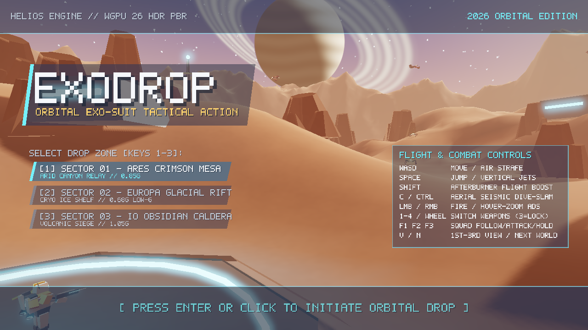
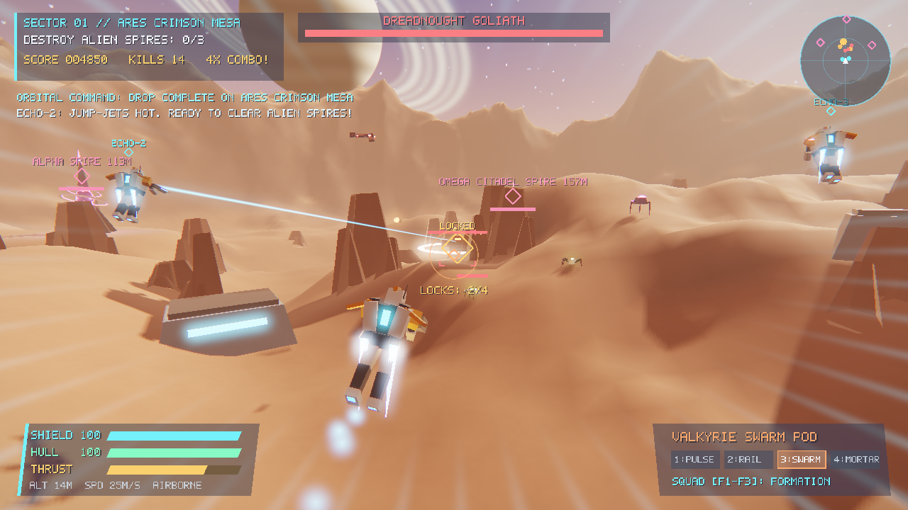
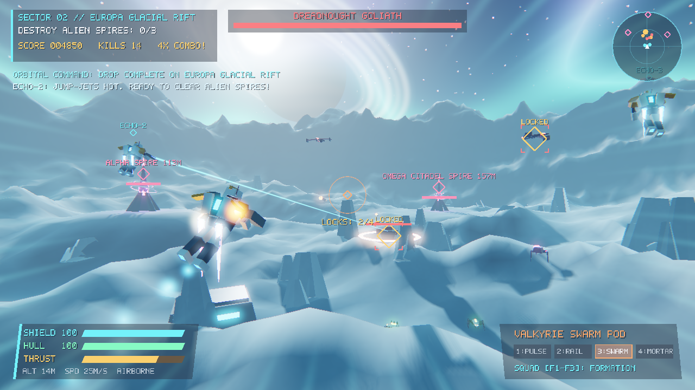
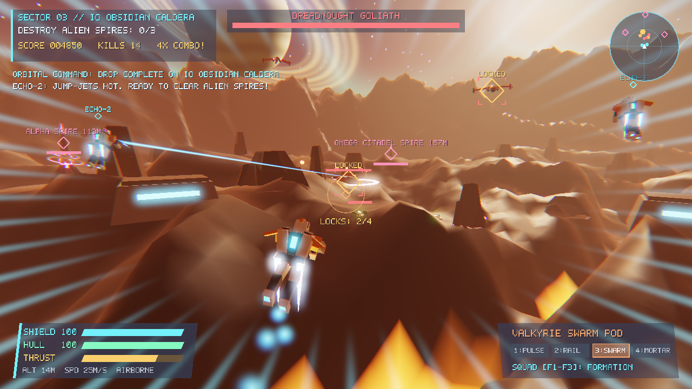
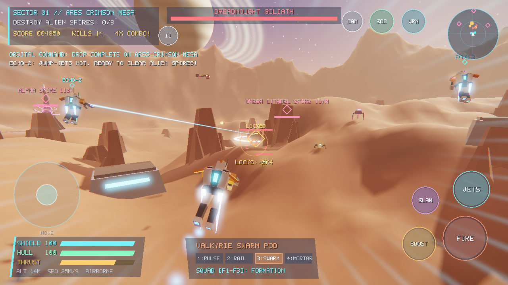

# EXODROP

> **A 2026 spiritual successor to classic orbital jump-suit action games — built from scratch in Rust on a custom `wgpu 26` HDR PBR 3D engine.**

Lead a three-trooper orbital drop squad equipped with powered jump-jet exo-suits across exotic planetary frontiers. Combine 6-DoF jetpack dogfighting, supersonic afterburner flight, hover-zoom sniping, multi-target homing missile salvos, seismic aerial dive-slams, and AI wingman tactics against bio-mechanical alien swarms.



## Gallery

| Ares Crimson Mesa (Sector 01) | Europa Glacial Rift (Sector 02) |
| :---: | :---: |
|  |  |

| Io Obsidian Caldera — Afterburner Flight (Sector 03) | Mobile Touch Controls HUD (iOS & Android) |
| :---: | :---: |
|  |  |

## Highlights

- **Brand-New Custom 3D Engine (Helios / `exo-*` crates)** — Zero external game engines and zero external asset packs. Every mesh, biome terrain, WGSL shader, HUD glyph, and real-time DSP sound effect is built in pure Rust:
  - **Modern `wgpu 26` GPU Pipeline** (Native Metal on macOS Apple Silicon, Vulkan on Linux/Windows, DX12 on Windows)
  - **2048×2048 Directional Shadow Mapping** with 3×3 PCF soft shadow filtering
  - **Linear HDR (`Rgba16Float`) Cook-Torrance GGX PBR Shading** with world-space micro-detail noise, hemisphere IBL, Fresnel rim highlights, and 16 live dynamic point lights
  - **Procedural Planetary Sky Dome** featuring Rayleigh/Mie scattering, starfield, banded ringed gas giant, and flowing aurora curtains
  - **Multi-Pass HDR Bloom + ACES Filmic Tone Mapping** with supersonic boost speed-lines and chromatic pulse
  - **Soft Radial HDR Particle & Ionized Beam System**
  - **Real-Time Procedural DSP Audio Engine** (`cpal`) synthesizing dynamic jetpack turbine whine, wind, weapons, lock-on chirps, shield alarms, and seismic explosions
- **Fluid 2026 Exo-Suit Mobility** (`120 Hz` fixed-step physics):
  - Vertical Jump-Jets (`Space`), 3D Afterburner Flight Boost (`Shift`), Precision Hover-ADS (`Right Click`), and Aerial Seismic Dive-Slam (`C` / `Ctrl`)
  - Distinct planetary gravity & hazards per sector (`0.85G` Ares Mesa, `0.68G` Low-G Europa Ice Shelf, `1.05G` Io Molten Caldera)
- **4-Weapon Sci-Fi Arsenal**:
  1. **VX-9 Pulse Carbine** — Rapid-fire cyan plasma rifle
  2. **Helios Rail-Lance** — Piercing hypervelocity ionized beam with critical weakspot hits
  3. **Valkyrie Swarm Pod** — Hold fire to multi-lock up to 4 targets with 3D HUD diamonds, release to launch curving homing missiles
  4. **Nova Arc-Mortar** — Arcing violet plasma sphere with massive AoE shockwave
- **Autonomous Jetpack Wingmen (`ECHO-2` & `ECHO-3`)**:
  - Two AI exo-suit troopers fly alongside you across canyons, engage hostiles, report on tactical comms, and obey live orders (`F1` Formation, `F2` Weapons Free / Engage, `F3` Hold Sector)
- **3 Planetary Sectors & Escalating Encounters**:
  - Fight Chitin Swarmers, Plasma Spitters, Aerial Interceptors, and the towering **Dreadnought Goliath** boss while destroying the 3 rotating Alien Spore Spires.

## Quick Start

Requires Rust 1.80+ (tested on macOS Apple Silicon with Rust 1.96).

```bash
# Run in release mode for silky-smooth native Metal/Vulkan/DX12 performance
cargo run --release -p exodrop

# Or launch directly into a specific sector (0 = Crimson Mesa, 1 = Europa, 2 = Io)
cargo run --release -p exodrop -- --sector 1

# Headless offscreen screenshot capture (no window required)
cargo run --release -p exodrop -- --screenshot out.png --sector 2 --cam aerial --size 1920x1080

# Preview mobile touch controls HUD on desktop
cargo run --release -p exodrop -- --touch-ui
```

## Mobile Builds (iOS & Android)

EXODROP compiles natively to **iOS** (Metal + UIKit + CoreAudio) and **Android** (Vulkan/GLES + NativeActivity + Oboe) with full multi-touch twin-stick controls, surface suspend/resume lifecycle, and a `Mobile` GPU quality preset (`1024×1024` shadow maps, single-pass HDR bloom).

```bash
# Prerequisites:
rustup target add aarch64-apple-ios aarch64-apple-ios-sim aarch64-linux-android

# Build iOS Simulator .app bundle (or pass "device" for physical iPhone/iPad)
./scripts/build_ios.sh sim release
./scripts/build_ios.sh device release

# Build Android arm64-v8a APK (uses ANDROID_HOME / NDK + Gradle)
./scripts/build_android.sh release
# Output: mobile/android/app/build/outputs/apk/debug/app-debug.apk
```

## Controls

| Input | Action |
| :--- | :--- |
| `W A S D` | Move / Aerial Strafe-Jets |
| `Mouse` | Aim / 3D Flight Vector |
| `Space` | Jump / Hold for Vertical Jump-Jets |
| `Shift` | Afterburner Thruster Dash & Flight Boost |
| `C` / `Ctrl` | Aerial Seismic Dive-Slam (while airborne) |
| `Left Click` | Fire Weapon (Hold & release for Swarm Pod multi-lock) |
| `Right Click` | Precision Hover-Zoom (ADS inertial dampeners) |
| `1` – `4` / `Wheel` | Switch Weapons (Pulse / Rail / Swarm / Mortar) |
| `F1` / `F2` / `F3` | Squad Orders: Follow / Engage Target / Hold Sector |
| `V` | Toggle Third-Person / First-Person Cockpit View |
| `N` | Jump to Next Planetary Sector |
| `F11` | Toggle Borderless Fullscreen |
| `Esc` | Pause / Release Cursor |

## Workspace Architecture

See [`ARCHITECTURE.md`](ARCHITECTURE.md) for a deeper breakdown of the engine design.

```text
crates/
├── exo-core      Fixed-timestep simulation clock (120 Hz), PRNG, biomes, input, weapon/squad types
├── exo-physics   Procedural planetary heightfields, AABB colliders, 6-DoF Exo-Suit physics, raycasts
├── exo-assets    Procedural PBR mesh synthesizer (Exo-Suit rig, 4 alien classes, structures, terrains)
├── exo-gfx       Custom wgpu 26 HDR PBR + shadow + sky + bloom + ACES + 2D HUD engine & PNG capture
├── exo-audio     Real-time cpal procedural DSP synthesizer
└── exodrop       Playable game binary, AI wingmen, enemy waves, weapons, HUD & menus
```

## License

MIT
